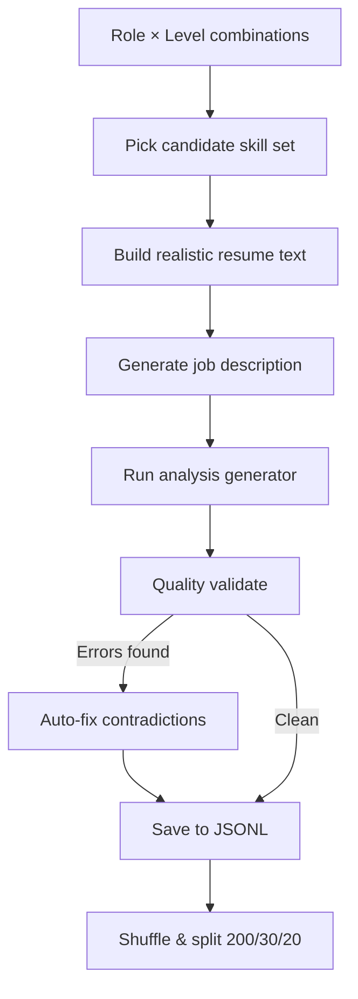

# ResumeFit AI — ML Dataset Documentation

> **SYNTHETIC DATA — NOT REAL CANDIDATE INFORMATION**
> All resumes, names, companies, and job descriptions in this dataset are entirely synthetic and machine-generated. No real individuals are represented.

---

## Table of Contents

1. [Dataset Purpose and Composition](#1-dataset-purpose-and-composition)
2. [Generation Methodology](#2-generation-methodology)
3. [Schema Description](#3-schema-description)
4. [Quality Assurance Measures](#4-quality-assurance-measures)
5. [Limitations of Synthetic Data](#5-limitations-of-synthetic-data)
6. [Split Rationale](#6-split-rationale)
7. [Known Biases and Mitigations](#7-known-biases-and-mitigations)
8. [File Inventory](#8-file-inventory)

---

## 1. Dataset Purpose and Composition

This dataset powers the **instruction-tuning** phase of ResumeFit AI — a system that analyzes a candidate's resume against a job description and returns a structured assessment with actionable recommendations.

### Task

Given a resume and a job description, the model must produce:

- Match scores (overall, technical, experience, keyword)
- Lists of matching and missing skills
- Actionable improvements to resume bullets
- ATS keyword analysis
- Section-by-section feedback
- A prioritized action plan

### Composition

| Split      | Examples | Purpose                                |
|------------|----------|----------------------------------------|
| Train      | 200      | Model fine-tuning                      |
| Validation | 30       | Hyperparameter tuning & early stopping |
| Test       | 20       | Final held-out evaluation              |
| **Total**  | **250**  |                                        |

### Role Coverage

| Role                | Examples (approx.) |
|---------------------|--------------------|
| software_engineer   | 25                 |
| python_developer    | 25                 |
| java_developer      | 25                 |
| data_scientist      | 25                 |
| ml_engineer         | 25                 |
| ai_engineer         | 25                 |
| data_analyst        | 25                 |
| backend_developer   | 25                 |
| frontend_developer  | 25                 |
| devops_engineer     | 25                 |

### Experience Level Coverage

| Level       | Description      | Approx. YoE |
|-------------|------------------|-------------|
| internship  | Student/intern   | 0           |
| entry_level | Early career     | 0–2 years   |
| mid_level   | Established      | 3–5 years   |
| senior      | Expert / leader  | 6–10 years  |

---

## 2. Generation Methodology

### Tooling

- **Language:** Python 3.x — standard library only (`json`, `random`, `re`, `uuid`, `pathlib`)
- **No external APIs, LLMs, or internet access** were used
- **Seed:** `random.seed(42)` for full reproducibility

### Generation Pipeline



### Resume Generation

1. A candidate name is chosen from pools of 30 first names × 30 last names (no real people).
2. Skills are sampled from role-specific pools (core / advanced / nice-to-have) weighted by seniority.
3. Resume bullets are generated using randomized action verbs and quantified metrics (%, $, latency).
4. Five resume styles are applied randomly: `default`, `concise`, `verbose`, `academic`, `bullet_heavy`.

### Job Description Generation

- Each JD is constructed from role/level-specific responsibility templates.
- Required and nice-to-have skills are sampled from the same role-skill pools.
- Level-appropriate experience requirements and blurbs are inserted.

### Analysis Generation

- `matching_skills` are computed by checking which candidate skills appear in the resume text (regex, case-insensitive).
- `missing_skills` are computed by finding required JD skills absent from the resume.
- Scores are computed from match ratios with realistic jitter.
- All recommendations are grounded in the resume's actual content.

---

## 3. Schema Description

Each JSONL line is a JSON object with the following structure:

### Top-Level Fields

| Field             | Type    | Description                                     |
|-------------------|---------|-------------------------------------------------|
| `id`              | string  | Unique identifier (`ex_NNNN_XXXXXXXX`)          |
| `role_category`   | string  | Lowercase underscore role name                  |
| `experience_level`| string  | `internship` / `entry_level` / `mid_level` / `senior` |
| `synthetic`       | bool    | Always `true`                                   |
| `input`           | object  | Model input (see below)                         |
| `output`          | object  | Expected model output (see below)               |

### `input` Object

| Field             | Type   | Description                        |
|-------------------|--------|------------------------------------|
| `resume_text`     | string | Full resume in plain text (150–400 words) |
| `job_description` | string | Full JD in plain text (100–250 words)     |
| `target_role`     | string | Display-name of target role               |

### `output` Object

| Field                    | Type    | Description                                                     |
|--------------------------|---------|-----------------------------------------------------------------|
| `overall_match`          | int     | 0–100 aggregate match score                                     |
| `technical_skill_match`  | int     | 0–100 technical skills alignment                               |
| `experience_match`       | int     | 0–100 years-of-experience fit                                  |
| `keyword_coverage`       | int     | 0–100 ATS keyword coverage                                     |
| `matching_skills`        | list[str] | Skills in resume that match JD requirements                  |
| `missing_skills`         | list[str] | Required JD skills absent from resume                        |
| `partial_matches`        | list[object] | Skills partially satisfied (see below)                    |
| `transferable_skills`    | list[object] | Candidate skills applicable to JD needs                   |
| `summary_recommendation` | string  | 3–5 sentence holistic assessment                               |
| `bullet_improvements`    | list[object] | Before/after resume bullet rewrites                       |
| `skills_to_add_to_resume`| list[str] | Skills to add to resume keywords section                   |
| `ats_keywords`           | list[str] | High-value ATS keywords from JD                            |
| `ats_issues`             | list[str] | Formatting/content issues affecting ATS parsing            |
| `section_analysis`       | object  | Per-section textual feedback (5 keys)                          |
| `action_plan`            | list[object] | Prioritized steps for the candidate                       |
| `hallucination_check`    | string  | Always `"PASS"` — signals no fabricated claims              |
| `data_quality_notes`     | string  | Generation metadata                                            |

#### `partial_matches` Item

```json
{
  "skill": "Kubernetes",
  "evidence": "Candidate has Docker listed in resume",
  "recommendation": "Container orchestration knowledge via Docker may partially satisfy Kubernetes requirement"
}
```

#### `transferable_skills` Item

```json
{
  "candidate_skill": "SQL",
  "jd_requirement": "Data querying",
  "explanation": "SQL proficiency covers data querying and reporting needs."
}
```

#### `bullet_improvements` Item

```json
{
  "original": "Worked on Python projects",
  "improved": "Engineered Python microservices that reduced deployment time by 35%",
  "reason": "Added action verb and quantified the impact.",
  "jd_relevance": "Directly aligns with JD requirement for Python expertise."
}
```

#### `action_plan` Item

```json
{
  "priority": "high",
  "action": "Add Docker to your skill set through an online course within 4-6 weeks.",
  "category": "skill_development"
}
```

Valid `priority` values: `high`, `medium`, `low`  
Valid `category` values: `resume_edit`, `skill_development`, `strategy`

#### `section_analysis` Keys

```json
{
  "professional_summary": "...",
  "technical_skills": "...",
  "experience": "...",
  "projects": "...",
  "education": "..."
}
```

---

## 4. Quality Assurance Measures

### Automated Validation (validate_dataset.py)

The validation script runs the following checks on every example:

| Check | Description |
|-------|-------------|
| Schema compliance | All required fields present and correct type |
| Score range | All int scores in [0, 100] |
| `matching_skills` grounding | Each skill verified in `resume_text` via regex |
| `missing_skills` integrity | Each skill confirmed absent from `resume_text` |
| `hallucination_check` | Must equal `"PASS"` |
| `section_analysis` completeness | All 5 section keys present |
| `action_plan` structure | Valid priority, category, non-empty action |
| `bullet_improvements` structure | All 4 required keys present |
| Duplicate detection | First 200 chars of resume_text compared |
| Token length estimation | Flags unusually short/long inputs |

### Auto-Fix During Generation

If validation errors are detected during generation:

- `matching_skills` containing skills absent from resume are removed
- `missing_skills` containing skills present in resume are removed

This ensures zero contradictions in the final dataset.

---

## 5. Limitations of Synthetic Data

> [!WARNING]
> Synthetic data introduces known biases and cannot fully replicate the diversity of real-world resumes. Models trained only on this data should be validated on human-written resumes before production use.

| Limitation | Impact | Mitigation |
|------------|--------|------------|
| Template-based resumes | Reduced linguistic diversity | 5 style variations applied |
| Limited vocabulary per role | Skill coverage may miss niche tools | Skill pools manually curated per role |
| Scores are heuristic | May not reflect true human recruiter judgment | Use as relative signal, not absolute truth |
| No company names are real | Cannot learn company-specific culture signals | Acceptable for skill-match task |
| Bullet metrics are random | Fake numbers could teach model to hallucinate metrics | Model should learn structure, not values |
| English only | No multilingual support | Extend skill pools and templates per language |
| No resume formatting | PDF/Word layout issues not modeled | Add formatting-aware preprocessing |

---

## 6. Split Rationale

| Split      | Size | Fraction | Purpose |
|------------|------|----------|---------|
| Train      | 200  | 80%      | Primary fine-tuning signal |
| Validation | 30   | 12%      | Monitor overfitting; tune LR/epochs |
| Test       | 20   | 8%       | Final unbiased evaluation (use once) |

> [!IMPORTANT]
> The test split must not be used for hyperparameter selection. Reserve it for a single final evaluation to get an unbiased estimate of model performance.

The dataset was shuffled with `random.seed(42)` before splitting, ensuring uniform role and level distribution across all three splits.

---

## 7. Known Biases and How to Mitigate

### Skill Bias

Skills in this dataset are limited to a manually curated taxonomy. Niche or emerging tools (e.g., domain-specific frameworks, regional tech stacks) are underrepresented.

**Mitigation:** Augment the `ROLE_SKILLS` pools with additional tools when extending the dataset. Consider crowdsourcing real job descriptions from public boards.

### Score Distribution Bias

Scores are generated from heuristic formulas with random jitter. The distribution may not match real recruiter score distributions (e.g., most real scores may cluster around 60–80).

**Mitigation:** Calibrate score boundaries using a small set of human-labeled examples and re-scale.

### Level Skew

Each level receives roughly equal representation. In the real world, entry-level and mid-level positions are far more common than senior roles.

**Mitigation:** Oversample entry_level and mid_level when training for production.

### Gender Neutrality

Names are drawn from a gender-neutral pool (e.g., "Alex", "Sam", "Jordan"). No gender information is embedded, reducing gender-based training signal.

### Geographic Bias

Companies and cities reflect a U.S.-centric technology hub perspective (SF, NYC, Austin, etc.).

**Mitigation:** Add international companies and cities to the pools when deploying outside the U.S. market.

---

## 8. File Inventory

```
ml/dataset/
├── generate_dataset.py      # Main generation script (stdlib only)
├── validate_dataset.py      # Schema + semantic validation
├── dataset_docs.md          # This documentation file
├── dataset_report.json      # Auto-generated validation report
├── raw/
│   └── dataset_raw.jsonl    # All 250 examples (unshuffled order)
└── splits/
    ├── train.jsonl          # 200 training examples
    ├── validation.jsonl     # 30 validation examples
    └── test.jsonl           # 20 test examples
```

---

*Generated by ResumeFit AI pipeline | SYNTHETIC DATA — NOT REAL CANDIDATE INFORMATION*
